# GitMap Deployment and Execution Instructions — Skill Guide

> **Skill Name:** `gitmap-deployment-and-execution-instructions`
> **Target Subsystem:** Fleet Binary Deployment, GitLab Public Distribution, 7-Zip Multi-Part Split Archiving, Aria2c Client Installers
> **Canonical Prompt:** [`01-prompts/14-execute/118-gitmap-deployment-and-execution-instructions.md`](file;01-prompts/14-execute/118-gitmap-deployment-and-execution-instructions.md)
> **Specification:** [`02-spec/21-app/459-gitmap-deployment-and-execution-instructions/01-architecture-spec.md`](file;02-spec/21-app/459-gitmap-deployment-and-execution-instructions/01-architecture-spec.md)

---

## 1. When to Activate This Skill
Activate this skill whenever the user or system tasks require:
1. Deploying compiled binaries from ANY repository (`gitmap`, `antigravity-manager`, or future repos) to GitLab.
2. Creating or synchronizing a deployment tracking repository under `<work_dir>/deploy/<repo_name>/`.
3. Generating multi-part 7-Zip LZMA2 split archives (`.7z.001`, `.7z.002`, ...) with SHA-256 integrity digests.
4. Uploading binary chunks to GitLab confidential issues or project attachments.
5. Synthesizing `binary-info.json` manifests and `aria2c`-accelerated client installers (`install.ps1`, `install.sh`).
6. Enforcing **Public** repository visibility in GitLab to eliminate Cloudflare 302 redirects to `/users/sign_in` (RCA-80).
7. Executing either standalone `deploy` commands or automated `release minor bump` ceremonies (`gitmap cpr`).
8. Providing copy-pasteable universal installation one-liners.

---

## 2. Core Operational Workflow

```mermaid
flowchart LR
    A["Target Repository"] --> B["Pre-Flight gitmap pull"]
    B --> C["Scaffold deploy/<repo>"]
    C --> D["Enforce GitLab Public Visibility (RCA-80)"]
    D --> E["7z LZMA2 Split Chunking (-v<size>)"]
    E --> F["Compute SHA-256 & Generate binary-info.json"]
    F --> G["Author install.ps1 & install.sh (aria2c)"]
    G --> H["Git Push Deploy Repo to GitLab"]
    H --> I["Output Universal One-Liners"]
```



---

## 3. Mandatory CLI Commands

### 3.1 Pre-Flight & Discovery
```bash
# Pre-flight pull in target repository
gitmap pull

# Search files or symbols without raw grep
gitmap aum search "<pattern>" [path]
gitmap find "<glob>" [path]
```

### 3.2 Deployment Scaffolding & Packaging
```powershell
# Create deployment repo bound to GitLab
gitmap repo create deploy-<project> --gitlab

# Slice target binary into split volumes (PowerShell)
& 7z a -t7z -m0=lzma2 -mx=9 "-v8m" "$stagingDir\$project-windows-amd64.7z" "$targetBinary"

# Calculate SHA-256 digest
(Get-FileHash -Path $chunkPath -Algorithm SHA256).Hash.ToLower()
```

### 3.3 Commit Discipline
```bash
# For feature additions:
gitmap cpf "deploy - <summary>"

# For bug fixes:
gitmap cbf "deploy - <summary>"

# For release minor bump:
gitmap cpr "vX.Y.Z - <summary>"
```

---

## 4. Universal Installation Summary Template

```text
=================================================================
  GitLab Binary Deployment Completed Successfully!
=================================================================
  Project:       <project> v<version>
  Archive:       7z Multi-Volume (<count> splits)
  Total Size:    <rawBytes> bytes (compressed: <archiveBytes> bytes)
  Confidential:  true
  GitLab Remote: https://gitlab.com/<namespace>/deploy-<project>

  Installer One-Liner (Windows PowerShell):
    irm https://gitlab.com/<namespace>/deploy-<project>/-/raw/main/install.ps1 | iex

  Installer One-Liner (Linux & macOS Bash):
    curl -fsSL https://gitlab.com/<namespace>/deploy-<project>/-/raw/main/install.sh | bash
=================================================================
```

---

## 5. Critical Invariants

1. **Public Deploy Visibility:** The deployment repository `deploy-<project>` MUST be Public in GitLab settings. If Private, unauthenticated one-liners will fail with Cloudflare HTML challenge redirects (`cUPMDTk:"/users/sign_in?..."`, RCA-80).
2. **Binary Exclusion:** NEVER commit raw binaries (`*.exe`) or `.7z` archives into the Git repository. Only `.gitignore`, `binary-info.json`, `install.ps1`, `install.sh`, and `readme.md` belong in Git.
3. **Aria2c Acceleration:** Client installers prioritize `aria2c -x 16 -s 16 -j 4` for high-speed multi-connection downloading.
4. **Atomic Binary Replacement:** Windows binary swaps use the dual-tier `.old`/`.bak` renaming pattern (RCA-07.11) with retry loops.
5. **No Routine Tests/Builds:** Do not run full test suites or build verification during routine turns.
