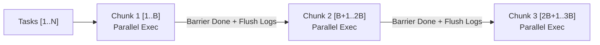

# Sequential Parallel Processing (SPP) Design Pattern — Cross-Language Coding Guidelines

- **Category**: Concurrency, Batching & Resource Governance
- **Rule ID**: `CG-CROSS-041`
- **Applicability**: Polyglot (Go, TypeScript, Python, Rust, PHP)
- **Status**: RATIFIED
- **AI Confidence**: High
- **Ambiguity**: None

---

## 1. Overview & Core Mission

When an application processes a collection of $N$ discrete tasks (e.g. Git repository operations, HTTP fleet requests, filesystem migrations, or database batch synchronizations), developers typically choose between two extreme patterns:

1. **Pure Sequential Loop:** Processes items one-by-one in a single thread.
2. **Unbounded Parallelism:** Launches all $N$ tasks simultaneously (e.g. unbounded goroutines, `Promise.all()`, or an unbounded thread pool).

Both extremes fail in production. Pure sequential processing leads to unacceptable execution times, while unbounded parallelism exhausts operating system resources (file descriptors, sockets, thread handles) and produces chaotic, interleaved log output.

This specification establishes the **Sequential Parallel Processing (SPP) Pattern** as a strict cross-language architectural standard:
- Tasks MUST be partitioned into sequential batches of size $B$ (default $B = 4$, bounded between 2 and 8).
- Items within each batch execute concurrently under an explicit synchronization barrier.
- Workers MUST write logs to isolated in-memory buffers instead of writing directly to stdout/stderr.
- Buffered logs are sequentially rendered to the terminal only upon batch completion.

---

## 2. Anti-Patterns: The Two Extremes

### ❌ Anti-Pattern A: Pure Sequential Loop
```typescript
// ❌ ANTI-PATTERN: Prohibitively slow wall-clock latency for large N
for (const repo of repositories) {
  await pullRepository(repo);
}
```
**Why this fails:**
- If each repository operation takes 2 seconds over network I/O, 100 repositories require over 3.3 minutes.
- Hardware cores and network bandwidth remain 80–90% idle during network round-trips.

---

### ❌ Anti-Pattern B: Unbounded Parallelism & Direct Stdout Interleaving
```go
// ❌ ANTI-PATTERN: Unbounded goroutines and stdout race conditions
for _, repo := range repositories {
	go func(r string) {
		fmt.Printf("Starting %s\n", r) // ❌ Race on stdout
		err := pullRepo(r)
		fmt.Printf("Finished %s: %v\n", r, err) // ❌ Mangled interleaved lines
	}(repo)
}
```
**Why this fails:**
1. **OS Resource Starvation:** Spawning hundreds of simultaneous child processes or socket connections triggers `EMFILE: too many open files` or socket connection timeouts.
2. **Stdout Collision & Log Interleaving:** Standard output from multiple concurrent tasks arrives mid-line, producing mangled, illegible terminal telemetry.
3. **Lock Contention:** Shared locks (such as `.git/index.lock` or local SQLite databases) collide violently under unbounded load.

---

## 3. The Canonical SPP Architecture



### 3.1 Design Principles
1. **Deterministic Batch Slicing:** Slices array/slice `targets[i:min(i+batchSize, n)]`.
2. **Strict Barrier Synchronization:** Batch $K+1$ cannot start until all items in Batch $K$ have resolved.
3. **Isolated Log Buffering:** Workers append logs to dedicated, thread-safe buffers (`RepoExecutionLog`).
4. **Deterministic Flush:** The printer flushes the buffer tree sequentially, ensuring zero interleaving.
5. **Positive Boolean Telemetry:** All telemetry states use affirmative prefixes (`isSuccess`, `hasErrors`, `isCompleted`).

---

## 4. Cross-Language Implementations

### 4.1 Go Implementation

```go
package batcher

import (
	"fmt"
	"sync"
)

type TaskResult struct {
	Name      string
	IsSuccess bool
	Logs      []string
}

func ProcessChunk(items []string) []TaskResult {
	results := make([]TaskResult, len(items))
	var wg sync.WaitGroup

	for idx, item := range items {
		wg.Add(1)

		go func(i int, target string) {
			defer wg.Done()
			results[i] = executeTask(target)
		}(idx, item)
	}

	wg.Wait()

	return results
}

func ProcessAll(items []string, batchSize int) {
	total := len(items)

	for i := 0; i < total; i += batchSize {
		end := min(i+batchSize, total)
		chunk := items[i:end]
		results := ProcessChunk(chunk)

		flushLogs(results)
	}
}
```

---

### 4.2 TypeScript / Node.js Implementation

```typescript
export interface TaskResult {
  name: string;
  isSuccess: boolean;
  logs: string[];
}

export async function processChunk(
  items: string[],
  worker: (item: string) => Promise<TaskResult>,
): Promise<TaskResult[]> {
  const promises = items.map((item) => worker(item));

  return Promise.all(promises);
}

export async function processAllSPP(
  items: string[],
  batchSize = 4,
  worker: (item: string) => Promise<TaskResult>,
): Promise<void> {
  const total = items.length;

  for (let i = 0; i < total; i += batchSize) {
    const chunk = items.slice(i, Math.min(i + batchSize, total));
    const results = await processChunk(chunk, worker);

    renderChunkLogs(results);
  }
}
```

---

### 4.3 Python Implementation

```python
from concurrent.futures import ThreadPoolExecutor
from dataclasses import dataclass, field
from typing import Callable, List

@dataclass
class TaskResult:
    name: str
    is_success: bool
    logs: List[str] = field(default_factory=list)

def process_chunk(
    items: List[str],
    worker: Callable[[str], TaskResult],
) -> List[TaskResult]:
    with ThreadPoolExecutor(max_workers=len(items)) as executor:
        return list(executor.map(worker, items))

def process_all_spp(
    items: List[str],
    batch_size: int,
    worker: Callable[[str], TaskResult],
) -> None:
    total = len(items)
    for i in range(0, total, batch_size):
        chunk = items[i : min(i + batch_size, total)]
        results = process_chunk(chunk, worker)
        render_chunk_logs(results)
```

---

## 5. Summary of Rules

| Rule ID | Directive | Enforcement |
|:--------|:----------|:------------|
| `SPP-01` | **Batch Size Cap**: Default batch size MUST be $B = 4$ ($2 \le B \le 8$). | Mandatory |
| `SPP-02` | **Zero Direct Stdout**: Worker threads MUST NOT write to standard output or error. | Mandatory |
| `SPP-03` | **Strict Barrier**: Next batch MUST NOT start until current batch completes. | Mandatory |
| `SPP-04` | **Affirmative Telemetry**: Booleans MUST use `is` or `has` prefixes (`isSuccess`, `hasErrors`). | Mandatory |
| `SPP-05` | **Panic/Exception Containment**: Workers MUST capture panics/exceptions and record failure safely. | Mandatory |

---

## 6. Verification & Acceptance Criteria

### AC-CG-CROSS-041: SPP Batching and Barrier Compliance
**Given** A collection of $N$ tasks processed by an SPP runner.
**When** The runner dispatches tasks.
**Then** Tasks are processed in chunks $\le B$, with a strict synchronization barrier between chunks and buffered log rendering.
