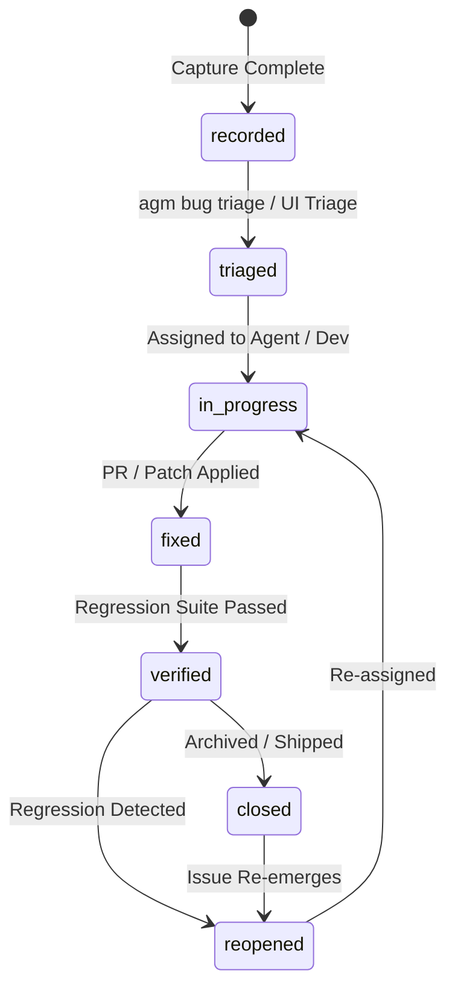

# Bug Recording Schema & State Machine Specification

## 1. Executive Summary & Purpose
This specification establishes the canonical, cross-platform database schema, state machine, and data transfer objects for the unified Bug Recorder subsystem across Antigravity Manager, Antigravity Tools, Cat MY, and GitMap. It guarantees that any autonomous AI agent or engineer can implement the persistence and state management layer with zero ambiguity, zero schema drift, and 100% type safety.

---

## 2. Universal 7-State Lifecycle Machine

### 2.1 State Transition Graph
The bug lifecycle strictly enforces a 7-state deterministic finite state machine (FSM). Unauthorized state jumps are rejected with error code `18255` (`BUG-INVALID-STATUS-TRANSITION`).



### 2.2 Canonical States and Invariants
1. `recorded`: Initial raw state captured by HUD, CLI, or test harness. All telemetry and snapshots are immutable.
2. `triaged`: Priority, severity, component ownership, and reproducibility score assigned.
3. `in-progress`: Active resolution underway by an AI subagent or human engineer. Workspace branch created.
4. `fixed`: Solution implemented and atomic commit verified.
5. `verified`: Automated rerun engine or QA pass confirms zero reproduction.
6. `closed`: Terminal archived state. Stored in local or remote cold storage.
7. `reopened`: State entered when verification fails or a regression occurs post-close.

### 2.3 Strict Transition Matrix

| Current State | Permitted Next States | Guard Condition |
| :--- | :--- | :--- |
| `recorded` | `triaged`, `closed` | `hasValidTelemetry` AND `hasStepSequence` |
| `triaged` | `in-progress`, `closed` | `hasAssignedOwner` OR `isAiAssigned` |
| `in-progress` | `fixed`, `triaged` | `hasCommitHash` OR `hasResolutionSummary` |
| `fixed` | `verified`, `reopened` | `hasPassingRerun` OR `hasVerifiedPatch` |
| `verified` | `closed`, `reopened` | `hasVerificationLogs` |
| `closed` | `reopened` | `hasRegressionReason` |
| `reopened` | `in-progress`, `triaged` | `hasUpdatedReproSteps` |

---

## 3. Relational Database Schema (SQLite 3.x)

### 3.1 `bug_records` Table (Master Entity)
```sql
CREATE TABLE IF NOT EXISTS bug_records (
    id TEXT PRIMARY KEY NOT NULL,                       -- UUID v4 formatted string
    session_id TEXT NOT NULL,                           -- Recording session identifier
    session_ref TEXT,                                   -- Optional external session reference or slug
    title TEXT NOT NULL,                                -- Human-readable issue summary
    description TEXT,                                   -- Detailed reproduction notes
    status TEXT NOT NULL DEFAULT 'recorded',           -- 7-state enum value
    severity TEXT NOT NULL DEFAULT 'medium',           -- low, medium, high, critical
    priority TEXT NOT NULL DEFAULT 'p2',               -- p0, p1, p2, p3
    component TEXT NOT NULL DEFAULT 'general',         -- UI, CLI, Backend, Database
    route TEXT NOT NULL,                               -- Active UI route or CLI command path
    step_count INTEGER NOT NULL DEFAULT 0,              -- Monotonic count of reproduction steps
    reproducibility_rate REAL NOT NULL DEFAULT 1.0,     -- Floating point score 0.0 - 1.0
    operating_system TEXT NOT NULL,                     -- windows, linux, darwin
    app_version TEXT NOT NULL,                          -- SemVer string (e.g., 6.613.0)
    user_environment TEXT NOT NULL,                     -- JSON string with screen, memory, locale
    is_reproducible INTEGER NOT NULL DEFAULT 1,         -- Boolean integer (1 = true, 0 = false)
    has_network_trace INTEGER NOT NULL DEFAULT 0,       -- Boolean integer
    has_visual_snapshot INTEGER NOT NULL DEFAULT 0,     -- Boolean integer
    has_backend_trace INTEGER NOT NULL DEFAULT 0,       -- Boolean integer
    is_offline INTEGER NOT NULL DEFAULT 0,              -- Boolean integer (1 = recorded offline)
    is_archived INTEGER NOT NULL DEFAULT 0,             -- Boolean integer (1 = archived)
    is_synced INTEGER NOT NULL DEFAULT 0,               -- Boolean integer (cloud synchronization)
    sync_id TEXT,                                       -- Remote sync identifier (Supabase ID)
    created_at TEXT NOT NULL,                           -- ISO-8601 UTC timestamp
    updated_at TEXT NOT NULL                            -- ISO-8601 UTC timestamp
);

CREATE INDEX IF NOT EXISTS idx_bug_records_status ON bug_records(status);
CREATE INDEX IF NOT EXISTS idx_bug_records_session ON bug_records(session_id);
CREATE INDEX IF NOT EXISTS idx_bug_records_created ON bug_records(created_at);
```

### 3.2 `bug_status_history` Table (Audit Trail)
```sql
CREATE TABLE IF NOT EXISTS bug_status_history (
    id TEXT PRIMARY KEY NOT NULL,                       -- UUID v4
    bug_id TEXT NOT NULL,                               -- Foreign key referencing bug_records(id)
    previous_status TEXT NOT NULL,                      -- Status before transition
    new_status TEXT NOT NULL,                           -- Status after transition
    transition_reason TEXT,                             -- Rationale for change
    changed_by TEXT NOT NULL,                           -- User name or agent identifier
    changed_at TEXT NOT NULL,                           -- ISO-8601 UTC timestamp
    FOREIGN KEY(bug_id) REFERENCES bug_records(id) ON DELETE CASCADE
);

CREATE INDEX IF NOT EXISTS idx_bug_status_history_bug ON bug_status_history(bug_id);
```

### 3.3 `bug_telemetry_events` Table (Granular Event Log)
```sql
CREATE TABLE IF NOT EXISTS bug_telemetry_events (
    id TEXT PRIMARY KEY NOT NULL,                       -- UUID v4
    bug_id TEXT NOT NULL,                               -- Foreign key referencing bug_records(id)
    step_number INTEGER NOT NULL,                       -- Monotonic 1-based sequence number
    event_type TEXT NOT NULL,                           -- click, input, navigation, error, api, roi
    target_selector TEXT,                               -- CSS Selector or XPath
    target_xpath TEXT,                                  -- Normalized DOM XPath
    target_tag TEXT,                                    -- HTML tag or CLI argument name
    target_text TEXT,                                   -- Inner text (sanitized)
    route TEXT NOT NULL,                                -- Route or working directory
    coordinates_json TEXT,                              -- Serialized screen/viewport/client coordinates
    delta_data TEXT,                                    -- JSON serialized delta coordinates or values
    before_image_path TEXT,                             -- Relative path to pre-event snapshot
    after_image_path TEXT,                              -- Relative path to post-event snapshot
    screenshot_kind TEXT NOT NULL DEFAULT 'viewport',   -- fullpage, diagram, viewport, crop
    backend_context_json TEXT,                          -- Extended backend context (PID, instance, prompt)
    backend_trace TEXT,                                 -- JSON serialized IPC/API trace
    dom_context TEXT,                                   -- Surrounding DOM HTML snippet (<= 1024 chars)
    error_message TEXT,                                 -- Captured console or backend error
    error_code INTEGER,                                 -- System or HTTP error code
    duration_ms INTEGER NOT NULL DEFAULT 0,             -- Event execution duration
    has_visual_diff INTEGER NOT NULL DEFAULT 0,         -- Boolean integer
    created_at TEXT NOT NULL,                           -- ISO-8601 UTC timestamp
    FOREIGN KEY(bug_id) REFERENCES bug_records(id) ON DELETE CASCADE
);

CREATE INDEX IF NOT EXISTS idx_bug_events_bug_step ON bug_telemetry_events(bug_id, step_number);
```

---

## 4. Universal JSON Envelopes (Cross-Language DTOs)

### 4.1 Master Bug Record Envelope (`bug_record.json`)
```json
{
  "id": "7f8b3c2a-9e1d-4a8f-b632-1a4e5d8c9012",
  "sessionId": "ses_20261117_004512_891",
  "title": "Failed to persist split-db configuration during project onboarding",
  "description": "Clicking 'Apply Split-DB' causes silent unhandled rejection on step 4.",
  "status": "recorded",
  "severity": "high",
  "priority": "p1",
  "component": "DatabaseManager",
  "route": "/settings/database",
  "stepCount": 6,
  "reproducibilityRate": 1.0,
  "operatingSystem": "windows",
  "appVersion": "6.613.0",
  "userEnvironment": {
    "screenWidth": 1920,
    "screenHeight": 1080,
    "pixelRatio": 1.0,
    "memoryGb": 32,
    "locale": "en-US",
    "theme": "dark"
  },
  "isReproducible": true,
  "hasNetworkTrace": true,
  "hasVisualSnapshot": true,
  "hasBackendTrace": true,
  "isSynced": false,
  "syncId": null,
  "createdAt": "2026-11-17T00:45:12.891Z",
  "updatedAt": "2026-11-17T00:45:12.891Z"
}
```

### 4.2 Granular Step Telemetry Envelope (`step_event.json`)
```json
{
  "id": "e4a1c890-5b23-4f91-8cd1-90a12e34f567",
  "bugId": "7f8b3c2a-9e1d-4a8f-b632-1a4e5d8c9012",
  "stepNumber": 4,
  "eventType": "click",
  "targetSelector": "#btn-apply-split-db",
  "targetXpath": "/html/body/div[1]/main/form/div[3]/button[2]",
  "targetTag": "BUTTON",
  "targetText": "Apply Split-DB",
  "route": "/settings/database",
  "deltaData": {
    "clickX": 450,
    "clickY": 620,
    "button": "left"
  },
  "beforeImagePath": "screenshots/step_004_before.webp",
  "afterImagePath": "screenshots/step_004_after.webp",
  "screenshotKind": "viewport",
  "backendTrace": {
    "command": "apply_split_db_config",
    "handler": "db_split::apply_config",
    "sourceFile": "crates/core/src/db_split.rs",
    "sourceLine": 142,
    "executionTimeMs": 48
  },
  "domContext": "<button id=\"btn-apply-split-db\" class=\"btn btn-primary\">Apply Split-DB</button>",
  "errorMessage": "sqlite3_open_v2 failed: read-only database",
  "errorCode": 18251,
  "durationMs": 48,
  "hasVisualDiff": true,
  "createdAt": "2026-11-17T00:45:14.210Z"
}
```

---

## 5. Software Architectural Invariants

### 5.1 Error Return Sovereignty
All database queries and mutations must reside behind dedicated Repository interfaces. Function implementations must adhere strictly to:
- Maximum 15 lines of code per function (target: <= 8 lines).
- Early return guard clauses with zero nested `if` statements.
- Return error immediately (`return err` or `return apperror.Wrap(...)`); never invoke `os.Exit` inside leaf repository functions.

### 5.2 Boolean Strictness
- All boolean variables, fields, parameters, and properties MUST be prefixed with `is` or `has` (e.g., `isReproducible`, `hasVisualSnapshot`, `hasNetworkTrace`).
- Negative boolean names (such as `isNotValid`, `unverified`, `hasNoErrors`) are banned without exception.
