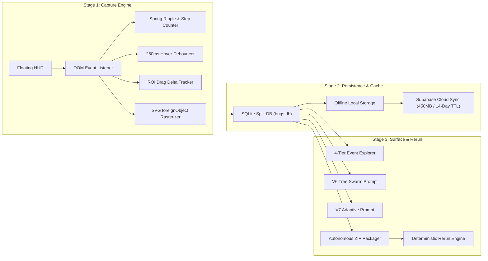
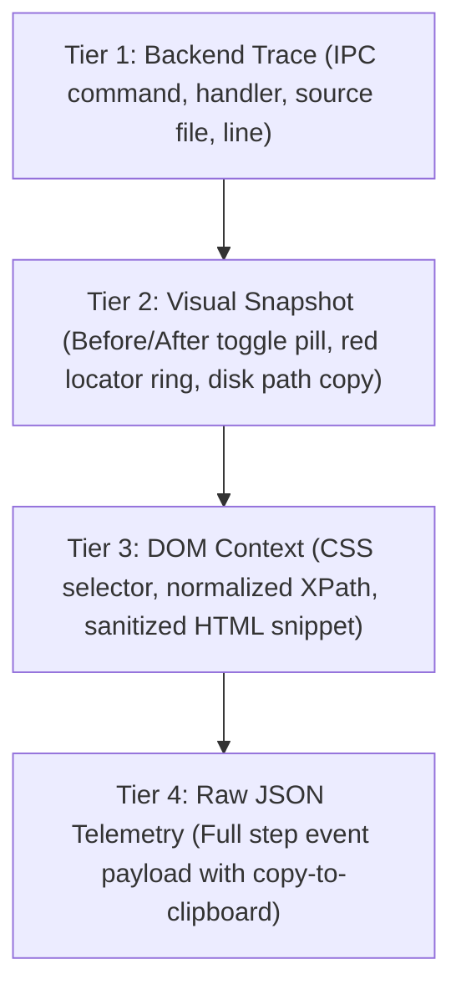

# Bug Recording Pipeline Specification

## 1. Executive Summary & Pipeline Overview
This specification defines the 3-stage runtime pipeline (Capture $\rightarrow$ Persist $\rightarrow$ Surface) that powers the unified Bug Recorder. The pipeline seamlessly bridges frontend UI interactions, low-level OS telemetry, in-memory SVG rasterization, local SQLite persistence, dual prompt synthesis, and CLI orchestration.



---

## 2. Floating HUD Invariants & Specifications

### 2.1 Visual & Structural Constraints
- **Corner Curvature**: Border-radius is strictly 5–6px (`rounded-md` or `rounded-[6px]`). Any circular or pill-shaped container (`rounded-full`) is banned to maintain desktop enterprise utility.
- **Viewport Boundary Clamping**: HUD dragging is constrained within the browser or desktop window with a mandatory `8px` boundary margin:
  $$\text{minX} = 8, \quad \text{maxX} = \text{windowWidth} - \text{hudWidth} - 8$$
  $$\text{minY} = 8, \quad \text{maxY} = \text{windowHeight} - \text{hudHeight} - 8$$
- **Collapsible Minimized State**: Collapses into a clean 28px height badge (`h-7`, `[06-bug] 01:42 [Expand ^]`), preserving screen real-estate during testing.
- **Dropdown Clipping Prevention**: The parent container must set `overflow-visible` so that internal menus and popovers (`z-[10100]`) project outward cleanly without clipping.
- **Self-Recording Shielding**: All HUD elements carry `data-recorder-hud="true"` and `data-audit-ignore="true"` attributes. The DOM event interception engine strictly ignores nodes matching these attributes, preventing feedback loops.

---

## 3. Event Explorer & 4-Tier Detail Inspector

### 3.1 Splitter Invariant
The vertical splitter dividing the step timeline and detail pane has a permanent fixed width `w-1.5` (`6px`). Dynamic width expansions on hover (e.g., `hover:w-2 -ml-0.5`) are strictly banned to eliminate layout shifts and visual jitter.

### 3.2 Lightbox Focus Preservation
When viewing a step screenshot in full resolution, dismissing the lightbox modal must immediately return keyboard and DOM focus to the active row in the step table. The state must never reset or cause the table to scroll to top.

### 3.3 4-Tier Detail Hierarchy
Every recorded step must render in a four-tier vertical inspector:



1. **Tier 1: Backend Trace**:
   - IPC Command name (`focus_or_launch_instance`, `db_split::apply_config`).
   - Handler function name and execution time.
   - Exact source file and line link (`crates/core/src/db_split.rs#L142`).
2. **Tier 2: Visual Snapshot**:
   - Dual-state toggle pill: `[ Before ]` | `[ After ]`.
   - Visual Locator Ring: Red circular indicator (`#ef4444`, 32px diameter, 2px border) pinpointing click or focus coordinates.
   - One-click copy button for the relative disk path (`screenshots/step_004_before.webp`).
3. **Tier 3: DOM Context**:
   - Element tag, attributes, and sanitized inner text.
   - Full CSS selector and canonical XPath (`/html/body/main/div[2]/button`).
   - Outer HTML snippet limited to 1024 characters.
4. **Tier 4: Raw JSON Telemetry**:
   - Monospace formatted, syntax-highlighted JSON view of `step_event.json`.

---

## 4. DOM & Visual Telemetry Engine

### 4.1 Spring Ripple & Step Counter
On every registered user click, a spring ripple effect renders immediately over the target coordinates:
- Dimensions: 64px $\times$ 64px cyan ring (`#06b6d4`, 2px solid).
- Physics Timing: `cubic-bezier(0.175, 0.885, 0.32, 1.275)` over 600ms.
- Step Number Badge: Monotonic 1-based badge (e.g., `#04`) anchored at center.

```css
/* Magic Spring Click Ripple Animation (Cat MY Standard) */
@keyframes recorderSpringPulse {
  0% {
    transform: translate(-50%, -50%) scale(0.2);
    opacity: 0.95;
  }
  35% {
    transform: translate(-50%, -50%) scale(1.35);
    opacity: 0.85;
    box-shadow: 0 0 24px rgba(6, 182, 212, 0.7), inset 0 0 12px rgba(6, 182, 212, 0.4);
  }
  65% {
    transform: translate(-50%, -50%) scale(1.0);
    opacity: 0.65;
  }
  100% {
    transform: translate(-50%, -50%) scale(1.2);
    opacity: 0;
  }
}

@keyframes recorderBadgePop {
  0% {
    transform: scale(0.6);
    opacity: 0;
  }
  30% {
    transform: scale(1.15);
    opacity: 1;
  }
  60% {
    transform: scale(1.0);
    opacity: 0.95;
  }
  85% {
    transform: scale(1.0);
    opacity: 0.85;
  }
  100% {
    transform: scale(0.9);
    opacity: 0;
  }
}

.recorder-spring-container {
  pointer-events: none;
  position: fixed;
  inset: 0;
  z-index: 999999;
  overflow: hidden;
  user-select: none;
}

.recorder-spring-pulse {
  position: absolute;
  width: 64px;
  height: 64px;
  border-radius: 9999px;
  border: 2px solid #06b6d4;
  background-color: rgba(6, 182, 212, 0.15);
  animation: recorderSpringPulse 600ms cubic-bezier(0.175, 0.885, 0.32, 1.275) forwards;
  pointer-events: none;
}

.recorder-step-badge {
  position: absolute;
  transform: translate(-50%, -50%);
  display: inline-flex;
  align-items: center;
  justify-content: center;
  padding: 2px 8px;
  border-radius: 9999px;
  background-color: rgba(15, 23, 42, 0.95);
  border: 1px solid rgba(6, 182, 212, 0.8);
  box-shadow: 0 4px 12px rgba(0, 0, 0, 0.5), 0 0 10px rgba(6, 182, 212, 0.5);
  color: #22d3ee;
  font-family: ui-monospace, SFMono-Regular, Menlo, Monaco, Consolas, monospace;
  font-size: 11px;
  font-weight: 700;
  letter-spacing: 0.05em;
  white-space: nowrap;
  animation: recorderBadgePop 600ms ease-out forwards;
  pointer-events: none;
}

@media (prefers-reduced-motion: reduce) {
  .recorder-spring-pulse,
  .recorder-step-badge {
    animation: none !important;
    transition: none !important;
  }
}
```

### 4.2 Hover Event Deduplication
To prevent log explosion from mouse movements:
- Deduplication Key: `${route}:${xpath}`.
- Debounce Period: 250 milliseconds.
- Element Filtering: Restrict hover telemetry to interactive elements only (`BUTTON`, `A`, `INPUT`, `SELECT`, `[role="button"]`, or elements with `cursor: pointer`).

### 4.3 ROI Drag Delta Tracking
When users drag bounding boxes or sliders:
- Track four deltas: $\Delta x = x_2 - x_1$, $\Delta y = y_2 - y_1$, $\Delta w = w_2 - w_1$, $\Delta h = h_2 - h_1$.
- Synthesize human-readable movement text (e.g., `Shifted right 120px, expanded height 45px`).
- Enforce 350ms click suppression guard (`lastRoiDragEndTime`) to prevent accidental click registrations on drag release.

### 4.4 Navigation Observer Pattern (`navigation-observer.ts`)
To capture client-side single-page app (SPA) routing:
1. Intercept `window.history.pushState`, `window.history.replaceState`, and `popstate` events.
2. Capture a synchronous "Before Navigation" screenshot prior to route alteration.
3. Debounce route settlement by 150ms (`pendingNavigationTimer`).
4. Capture an "After Navigation" screenshot once target route DOM mounts and stabilizes.
5. Record synthetic event `navigation` with `fromRoute`, `toRoute`, `screenName`, and before/after screenshot IDs.

### 4.5 Diagnostic Stack Trace Parser (`error-stack-parser.ts`)
When unhandled errors or console exceptions occur during recording:
1. Clean raw URLs removing dev-server prefixes (`/@fs/`, `webpack:///`, query tokens).
2. Filter internal framework frames (`node_modules`, `@vite`, `chunk-`, `@tanstack`).
3. Extract authentic, readable source locations: `primarySourceLocation: "StandardCanvas.tsx:316"`.
4. Output strongly-typed `ParsedStackTraceResult` attaching directly to `bug_telemetry_events.backend_trace`.

---

## 5. In-Memory SVG `foreignObject` Rasterization

### 5.1 Elimination of `getDisplayMedia`
Traditional screenshot capture triggers intrusive browser permission dialogs. The unified recorder utilizes in-memory SVG `foreignObject` rasterization:
1. Clone target DOM element or document root.
2. In-line computed CSS styles and font definitions.
3. Convert external image URLs to base64 Data URIs.
4. Embed serialised HTML inside an SVG `<foreignObject>` element:
   ```xml
   <svg xmlns="http://www.w3.org/2000/svg" width="1920" height="1080">
     <foreignObject width="100%" height="100%">
       <div xmlns="http://www.w3.org/1999/xhtml">
         <!-- Inlined DOM Tree -->
       </div>
     </foreignObject>
   </svg>
   ```
5. Draw SVG to offscreen HTML5 Canvas and export as WebP or PNG.

### 5.2 Honest Screenshot Kinds
Synthetic canvas captures must never claim to be operating system full-screen captures. The system enforces strict enum values:
- `"fullpage"`: Complete scrollable document height capture.
- `"diagram"`: Specific canvas, chart, or graph element capture.
- `"viewport"`: Currently visible browser or webview window area.
- `"crop"`: Bounded rectangular region of interest.

---

## 6. Storage & Cloud Synchronization Architecture

### 6.1 Split-DB Architecture
To guarantee thread safety and prevent lock contention with core application data, bug recording utilizes an isolated SQLite database:
- Path: `.logs/recorded-bugs/bugs.db`.
- Mode: WAL mode (`PRAGMA journal_mode = WAL; PRAGMA busy_timeout = 5000;`).

### 6.2 Offline-First Sync & Cloud Quota Management
- Offline Cache: Serialized into local IndexedDB/localStorage key `cat:recorder:offline_sessions`.
- Auto-Flush: Network listener flushes pending records on `window.addEventListener('online')`.
- Supabase Quota Enforcer:
  - Maximum storage quota per workspace: **450 MB**.
  - Eviction Policy: Automated 14-day Time-To-Live (TTL). Records older than 14 days with status `closed` are purged locally and remotely.

---

## 7. Dual Prompt Synthesis & Autonomous ZIP Packaging

### 7.1 V6 Prompt Output (Tree Swarm & Brain Roadmap)
Generates high-precision markdown instructions adhering to the V6 agent prompt format:
- Tree Swarm Hierarchy with coordinator and worker responsibilities.
- 100-step granular roadmap linking reproduction steps directly to codebase files.
- Atomic GitMap commit standards (`gitmap cbf`).
- Embedded reproduction bash and PowerShell commands.

### 7.2 V7 Prompt Output (Adaptive Dynamic Prompt)
Generates lightweight, context-aware prompt instructions tailored for LLM reasoning models with constrained context windows.

### 7.3 Dynamic Middle Text Variation Rotation
To prevent repetitive prompt saturation during iterative testing cycles, the rerun engine dynamically cycles through 10 distinct middle text variations:

$$\text{Index} = (\text{startIdx} + \text{round} - 1) \pmod{10}$$

1. `"Rerunning step sequence with strict error tracking..."`
2. `"Re-executing captured interaction flow with telemetry verification..."`
3. `"Reproducing defect steps under active process inspection..."`
4. `"Validating system state against recorded event timeline..."`
5. `"Executing automated replay sequence for regression analysis..."`
6. `"Re-triggering recorded user workflow with backend logging..."`
7. `"Performing deterministic step playback and boundary validation..."`
8. `"Tracing execution path through recorded reproduction checkpoints..."`
9. `"Re-evaluating interaction sequence against expected state..."`
10. `"Running targeted regression audit across recorded steps..."`

### 7.4 Human-Action Instruction Synthesis (`formatHumanActionInstruction`)
For clear, natural AI ingestion, raw DOM actions are transformed into concise human directives:
- Clicks: `"click on the '{cleanLabel}' {componentType}"`
- Inputs: `"enter \"{value}\" into the '{cleanLabel}' input field"`
- Drag/ROI: `"drag {handle} of the '{cleanLabel}' region"`
- Hover: `"hover over the '{cleanLabel}' element"`
- Navigations: `"navigate to '{screenName}' (route: {route})"`
- Format: `Step #{seqNumber} (+{elapsedMs}ms): On {screenName} (route: {route}), {actionPhrase} (XPath: {xpath}) [Source: {file} | Backend: {handler}]. Evidence: {link}.`

### 7.5 Autonomous ZIP Package Structure
The export utility packs a fully self-contained artifact:
```text
bug_<id>_reproduce.zip
├── manifest.json                  # Full metadata and system environment
├── reproduce.bat                  # Windows one-click replay script
├── reproduce.sh                   # Linux/macOS one-click replay script
├── steps.db                       # SQLite slice of telemetry events
├── telemetry.json                 # Formatted JSON stream
└── screenshots/                   # WebP/PNG before and after images
    ├── step_001_before.webp
    ├── step_001_after.webp
    └── ...
```

---

## 8. CLI Parity Suite (`agm bug`)

All UI actions map 1:1 to command-line operations:

| CLI Command | Equivalent UI Action |
| :--- | :--- |
| `agm bug record --route /settings` | Click "Start Recording" button in HUD |
| `agm bug list --status recorded` | Open Bug Event Explorer Table |
| `agm bug triage <id> --p1 --high` | Select Priority & Severity dropdowns |
| `agm bug export <id> --zip` | Click "Download ZIP" button |
| `agm bug rerun <id> --headless` | Click "Rerun Steps" replay engine button |
