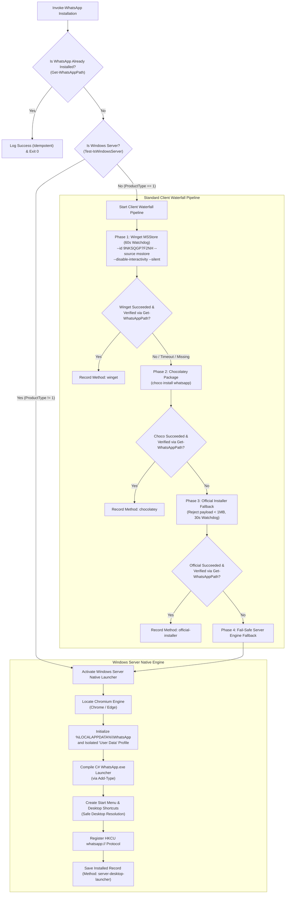

# Specification 21.01: Windows Server WhatsApp Architecture & Fallback Engine

> **Spec ID:** `02-spec/21-app/install-whatsapp-on-windows-server/01-windows-server-architecture.md`  
> **Feature Version:** `1.1.0`  
> **Status:** `Active / Authoritative`  
> **Domain:** `Windows Server Desktop Tooling, Enterprise Messaging & Application Launcher Architecture`  
> **Target Environments:** `Windows Server 2019, Windows Server 2022, Windows Server 2025, Windows 10, Windows 11`  
> **Script Binding:** `scripts/49-install-whatsapp/run.ps1` (ID: 49)  
> **Parent Spec:** `02-spec/21-app/install-whatsapp-on-windows-server/readme.md`  

---

## 1. Executive Summary & Root Cause Analysis

On standard consumer editions of Windows (Windows 10/11), WhatsApp distribution relies on the Microsoft Store package (`9NKSQGP7F2NH`) deployed via `winget` or Store services. However, on enterprise Windows Server editions (2019, 2022, 2025), installing WhatsApp through conventional channels consistently fails due to architectural constraints:

1. **Store Platform Incompatibility (`0x803fb104`)**:
   - The Microsoft Store client is not installed or enabled by default on Windows Server.
   - Calling `winget install --id 9NKSQGP7F2NH --source msstore` generates fatal error `0x803fb104`:
     ```text
     0x803fb104 : The package is not compatible with the current Windows version or platform.
     ```
   - WhatsApp's MSIX package manifest explicitly declares targeting for the `Windows.Desktop` device family, causing the Windows Server Appx/MSIX deployment engine to reject package registration.

2. **Win32 Legacy Setup Deprecation**:
   - Meta discontinued standalone desktop setup installers (`WhatsAppSetup.exe`). The historical endpoint returns an HTTP 302 redirecting to `https://web.whatsapp.com/#` or provides a stub. Any payload under 1MB is rejected as an invalid installer stub.

3. **External Process Deadlocks & Hangs**:
   - Running interactive package managers (`winget`, `msiexec`, or `choco`) on headless or RDP server sessions without strict execution timeouts risks indefinite process hangs due to hidden credential prompts, terms acceptance prompts, or modal dialogs.

To solve this, Script 49 implements a dual-mode installation engine:
- **Windows Server Path**: Deploys a native compiled desktop launcher at `%LOCALAPPDATA%\WhatsApp\WhatsApp.exe` backed by an isolated Chromium profile (`%LOCALAPPDATA%\WhatsApp\User Data`), desktop integration, shell shortcuts, and `whatsapp://` protocol handler.
- **Standard Windows Client Path**: Orchestrates an automated waterfall starting with `winget` (using strict non-interactive flags and a 60s timeout watchdog), falling back to Chocolatey, followed by official installer fallback (rejecting stubs < 1MB), and culminating in the Native Server Engine as a resilient fail-safe.

---

## 2. Operating System Classification Architecture

### 2.1 OS Classification Logic

Operating system type detection deterministically differentiates Windows Server editions from workstation clients using the Win32 WMI / CIM `ProductType` property:

```powershell
function Get-IsWindowsServer {
    [CmdletBinding()]
    param()

    $osInfo = Get-CimInstance -ClassName Win32_OperatingSystem
    $isServer = $osInfo.ProductType -ne 1

    return $isServer
}
```

### 2.2 ProductType Evaluation Reference Table

| ProductType Value | OS Designation | Classification | Execution Strategy |
|---|---|---|---|
| `1` | Workstation / Client (Windows 10, Windows 11) | Standard Client | Winget MSStore -> Chocolatey -> Official Fallback -> Server Engine Fallback |
| `2` | Domain Controller (Windows Server 2019/2022/2025) | Windows Server | Native Desktop Launcher Engine |
| `3` | Member Server (Windows Server 2019/2022/2025) | Windows Server | Native Desktop Launcher Engine |

When `isWindowsServer` evaluates to `$true`, the installer bypasses consumer Store operations and immediately activates the Windows Server Native Desktop Launcher pipeline.

---

## 3. Dual-Mode Installation Pipelines

### 3.1 Pipeline Flow Diagram



### 3.2 Standard Windows Client Waterfall Phases

1. **Phase 1: Winget MSStore Deployment**:
   - Executes `winget install --id 9NKSQGP7F2NH --source msstore --silent --accept-package-agreements --accept-source-agreements --disable-interactivity`.
   - Constrained by a strict `60` second process watchdog.
   - If winget exits cleanly and `Get-WhatsAppPath` resolves the installed executable, installation completes with method `winget`.
2. **Phase 2: Chocolatey Deployment**:
   - If winget is unavailable, times out, or fails post-install verification, execution automatically transitions to Chocolatey.
   - Invokes `Install-ChocoPackage -PackageName $WaConfig.chocoPackage`.
   - Verified via `Get-WhatsAppPath`.
3. **Phase 3: Official Installer Fallback**:
   - If Chocolatey fails, downloads installer payload from official fallback URL (`WhatsAppSetup.exe`).
   - Rejects any file payload smaller than `1MB` to prevent corrupt stubs or HTML redirect artifacts.
   - Executes with `/S` silent argument constrained by a `30` second watchdog.
4. **Phase 4: Server Engine Fail-Safe**:
   - If all client package managers fail, the script automatically deploys the Windows Server Native Desktop Launcher engine, guaranteeing functional WhatsApp access on every machine.

---

## 4. Windows Server Native Desktop Launcher Engine

### 4.1 Directory & Binary Layout

The native launcher is deployed to the user local application directory:

```text
%LOCALAPPDATA%\WhatsApp\
├── WhatsApp.exe              # Native compiled launcher entrypoint
└── User Data\                # Dedicated isolated Chromium profile
    ├── Default\
    └── Local State
```

### 4.2 Isolated Browser User-Data-Dir

To ensure enterprise stability, security isolation, and prevent state collisions with the user's personal or enterprise browsing sessions:
- The launcher executes with `--user-data-dir="%LOCALAPPDATA%\WhatsApp\User Data"`.
- The profile is strictly segregated from `%LOCALAPPDATA%\Google\Chrome\User Data` and `%LOCALAPPDATA%\Microsoft\Edge\User Data`.
- Session state, cookies, IndexedDB records, and web cache persist exclusively within this isolated container.

### 4.3 Host Browser Engine Selection

The launcher dynamically queries and binds to the highest-priority installed Chromium-based browser:
1. Google Chrome (64-bit Program Files, 32-bit Program Files, Local AppData)
2. Microsoft Edge (64-bit Program Files, 32-bit Program Files, Local AppData)
3. PATH-registered `chrome.exe` or `msedge.exe` via `Get-Command`

If neither browser engine is present, a structured error is raised with level `error`.

### 4.4 Runtime Argument Construction & C# Launcher Compilation

The native launcher binary (`WhatsApp.exe`) is compiled in-memory via `Add-Type` as a lightweight C# Win32 GUI application:
- Standard launch flags:
  ```text
  --app=https://web.whatsapp.com/ --user-data-dir="%LOCALAPPDATA%\WhatsApp\User Data" --class=WhatsApp --name=WhatsApp
  ```
- URL protocol passthrough: When launched via `whatsapp://...`, the argument is appended to the browser launch command line.

---

## 5. Desktop Integration & Protocol Handler

### 5.1 Shell Shortcut Integration & Safe Desktop Resolution

Shortcuts are deployed to standard system locations with graceful fallback if the Desktop directory is absent:

1. **Start Menu Shortcut**:
   - Path: `%APPDATA%\Microsoft\Windows\Start Menu\Programs\WhatsApp.lnk`
   - TargetPath: `%LOCALAPPDATA%\WhatsApp\WhatsApp.exe`
   - IconLocation: `[BrowserPath],0`
   - Description: `WhatsApp Desktop Client`

2. **Desktop Shortcut**:
   - Path: Resolved dynamically via `[System.Environment]::GetFolderPath([System.Environment+SpecialFolder]::Desktop)`.
   - Safety Guard: If the Desktop folder path does not exist on disk (e.g. in headless automation or restricted profiles), the installer creates the directory or skips shortcut creation without throwing fatal exceptions.

### 5.2 Protocol Handler Architecture (`whatsapp://`)

WhatsApp deep-links (`whatsapp://send?phone=...`) are registered under `HKCU:\Software\Classes\whatsapp` without requiring administrative elevation:

```text
HKCU:\Software\Classes\whatsapp
├── (Default) = "URL:WhatsApp Protocol"
├── URL Protocol = ""
└── shell\open\command
    └── (Default) = "\"%LOCALAPPDATA%\WhatsApp\WhatsApp.exe\" \"%1\""
```

---

## 6. Execution Watchdog & Process Safety

### 6.1 Bounded Process Execution

All external process invocations (`winget`, `choco`, `WhatsAppSetup.exe`) must never hang or block unattended automation. The execution watchdog enforces strict bounded execution windows:

```powershell
function Invoke-ProcessWithTimeout {
    param(
        [Parameter(Mandatory)] [string]$FilePath,
        [Parameter(Mandatory)] [string[]]$ArgumentList,
        [Parameter(Mandatory)] [int]$TimeoutSeconds
    )

    try {
        $proc = New-Object System.Diagnostics.Process
        $proc.StartInfo = New-ProcessStartInfo -FilePath $FilePath -ArgumentList $ArgumentList
        [void]$proc.Start()
        $hasExited = $proc.WaitForExit($TimeoutSeconds * 1000)

        if (-not $hasExited) {
            $proc.Kill()

            return @{ isSuccess = $false; isTimeout = $true; exitCode = -1 }
        }

        $isZero = $proc.ExitCode -eq 0

        return @{ isSuccess = $isZero; isTimeout = $false; exitCode = $proc.ExitCode }
    } catch {
        return @{ isSuccess = $false; isTimeout = $false; exitCode = -1 }
    }
}
```

### 6.2 Timeout Threshold Reference

- **Winget Package Deployment**: `60` seconds maximum. Terminated via `$proc.Kill()` upon expiration.
- **Official Installer Execution**: `30` seconds maximum.
- **Network / Package Download**: `30` seconds timeout.
- **Launcher Binary Compilation**: Handled synchronously in-memory via `Add-Type`.

### 6.3 Non-Interactive Flags

To prevent blocking modal dialogs or interactive prompts on headless systems:
- Winget arguments mandatory: `--silent --accept-package-agreements --accept-source-agreements --disable-interactivity`
- Official installer arguments mandatory: `/S` (silent unattended execution)

---

## 7. Idempotency & Verification Engine

Prior to performing file generation, compilation, or package manager calls, `Install-WhatsApp` executes `Get-WhatsAppPath`:
- Checks `%LOCALAPPDATA%\WhatsApp\WhatsApp.exe`
- Checks `%LOCALAPPDATA%\Programs\WhatsApp\WhatsApp.exe`
- Checks `%LOCALAPPDATA%\Microsoft\WindowsApps\WhatsApp.exe`
- Checks `%ProgramFiles%\WhatsApp\WhatsApp.exe`
- Checks `${env:ProgramFiles(x86)}\WhatsApp\WhatsApp.exe`
- Checks PATH resolution via `Get-Command WhatsApp.exe`

If any valid executable is discovered, the installer records the existing installation, outputs an informational log, and exits cleanly with exit code `0`.

---

## 8. Deep Cleanup Engine (`Uninstall-WhatsApp`)

When `run.ps1 uninstall` is executed, the uninstaller purges all created artifacts:
1. **Chocolatey Package**: Invokes `Uninstall-ChocoPackage -PackageName $WaConfig.chocoPackage`.
2. **Native Launcher Binary**: Deletes `%LOCALAPPDATA%\WhatsApp\WhatsApp.exe`.
3. **Shortcuts**: Deletes Start Menu and Desktop `.lnk` files across user and public profiles.
4. **Registry Protocol**: Deletes `HKCU:\Software\Classes\whatsapp` and application registry entries.
5. **Tracking Records**: Calls `Remove-InstalledRecord -Name "whatsapp"` and `Remove-ResolvedData`.

---

## 9. Acceptance Criteria

| Criteria ID | Requirement | Verification Method |
|---|---|---|
| `AC-01` | On Windows Server (`ProductType -ne 1`), native launcher engine is activated directly. | `Test-IsWindowsServer` returns `$true`, launcher compiles at `%LOCALAPPDATA%\WhatsApp\WhatsApp.exe`. |
| `AC-02` | On standard Windows client (`ProductType -eq 1`), winget is attempted first with non-interactive flags. | Process starts with `--disable-interactivity --accept-package-agreements --accept-source-agreements` with 60s timeout. |
| `AC-03` | If winget fails or is missing, falls back to Chocolatey, then official installer, then native engine. | Waterfall cascade returns `$true` upon any succeeding phase. |
| `AC-04` | Official installer download rejects corrupt stubs or HTML payloads smaller than 1MB. | Verified with `$item.Length -ge 1MB` guard clause. |
| `AC-05` | External processes are killed if execution exceeds timeout threshold (60s winget, 30s setup). | Process kill verified on timeout with no unattended hangs. |
| `AC-06` | Desktop shortcut creation handles missing desktop folders gracefully without fatal errors. | Safe folder check and creation via `[System.Environment+SpecialFolder]::Desktop`. |
| `AC-07` | All code complies strictly with AGENTS.md rules (`is*`/`has*` booleans, micro-functions <= 15 lines, no nested ifs). | Static code review and lint validation passing. |

---

## 10. Architectural Invariant Adherence

1. **Strict Boolean Standard**: All booleans use `is*` or `has*` (`isWindowsServer`, `hasWinget`, `isTimeout`, `hasBinary`, `isSuccess`, `hasDesktop`).
2. **Micro-Functions**: Target <= 8 lines of execution logic (max 15 lines per function).
3. **Control Flow**: Zero nested `if` statements — guard clauses and early returns only.
4. **Vertical Whitespace**: Blank lines mandatory before `if`, after `}`, before `return`.
5. **Strict Relative Git Paths**: All documented paths relative to git root (`02-spec/...`, `scripts/...`).
