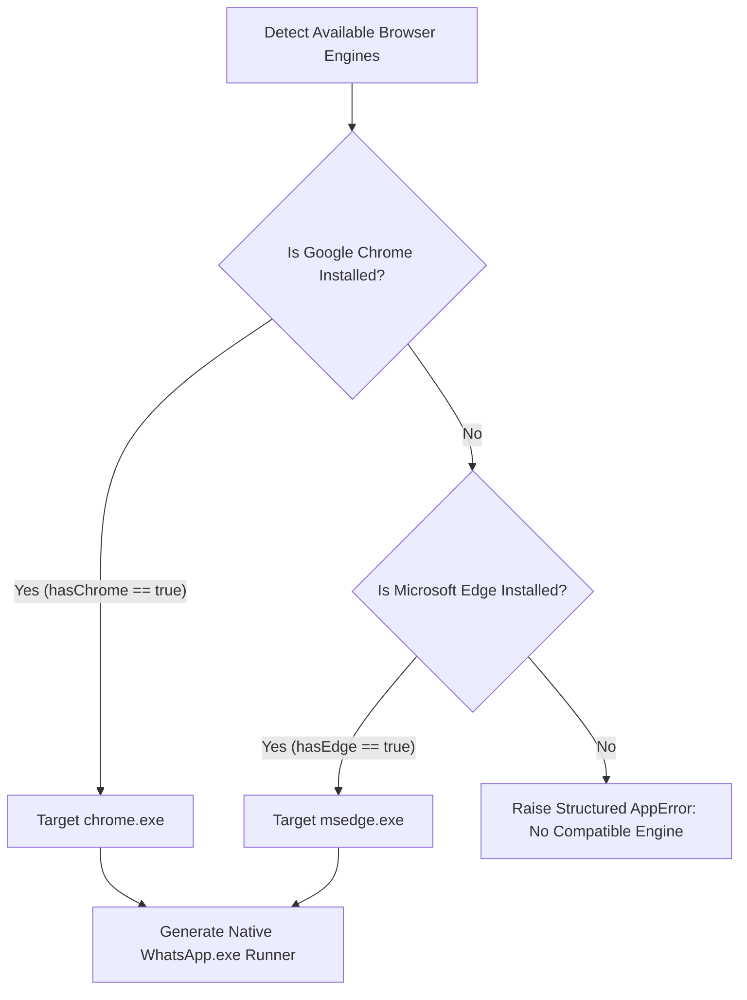

# Specification 21.01: Windows Server WhatsApp Architecture & Fallback Engine

> **Spec ID:** `02-spec/21-app/install-whatsapp-on-windows-server/01-windows-server-architecture.md`  
> **Feature Version:** `1.0.0`  
> **Status:** `Active / Authoritative`  
> **Domain:** `Windows Server Desktop Tooling, Enterprise Messaging & Application Launcher Architecture`  
> **Target Environments:** `Windows Server 2019, Windows Server 2022, Windows Server 2025`  
> **Script Binding:** `scripts/49-install-whatsapp/run.ps1` (ID: 49)  
> **Parent Spec:** `02-spec/21-app/install-whatsapp-on-windows-server/readme.md`  

---

## 1. Executive Summary & Root Cause Analysis

On standard consumer editions of Windows (Windows 10/11), WhatsApp distribution relies on the Microsoft Store package (`9NKSQGP7F2NH`) deployed via `winget` or Store services. However, on enterprise Windows Server editions (2019, 2022, 2025), installing WhatsApp through conventional channels consistently fails due to architectural constraints:

1. **Store Platform Incompatibility (`0x803fb104`)**:
   - The Microsoft Store client is not installed or enabled by default on Windows Server.
   - Calling `winget install --id 9NKSQGP7F2NH --source msstore` generates fatal error `0x803fb104`:
     ```text
     0x803fb104 : The package is not compatible with the current Windows version or platform.
     ```
   - WhatsApp's MSIX package manifest explicitly declares targeting for the `Windows.Desktop` device family, causing the Windows Server Appx/MSIX deployment engine to reject package registration.

2. **Win32 Legacy Setup Deprecation**:
   - Meta discontinued standalone desktop setup installers (`WhatsAppSetup.exe`). The historical endpoint returns an HTTP 302 redirecting to `https://web.whatsapp.com/#`.

3. **External Process Deadlocks**:
   - Running interactive package managers (`winget`, `msiexec`, or `choco`) on headless or RDP server sessions without strict execution timeouts risks process hangs due to hidden credential or confirmation prompts.

To solve this, the Windows Server engine provides a robust, self-contained native application wrapper at `%LOCALAPPDATA%\WhatsApp\WhatsApp.exe`, backed by an isolated browser profile, desktop integration, protocol handler, and bounded execution watchdogs.

---

## 2. Operating System Classification Architecture

### 2.1 OS Classification Logic

Operating system type detection must deterministically differentiate Windows Server from workstation clients:

```powershell
function Get-IsWindowsServer {
    [CmdletBinding()]
    param()

    $osInfo = Get-CimInstance -ClassName Win32_OperatingSystem
    $isServer = $osInfo.ProductType -ne 1

    return $isServer
}
```

### 2.2 ProductType Evaluation Reference Table

| ProductType Value | OS Designation | Classification | Execution Strategy |
|---|---|---|---|
| `1` | Workstation / Client (Windows 10, Windows 11) | Standard Client | Winget / Store / Official Fallback |
| `2` | Domain Controller (Windows Server) | Windows Server | Native Desktop Launcher Engine |
| `3` | Member Server (Windows Server) | Windows Server | Native Desktop Launcher Engine |

When `isWindowsServer` evaluates to `$true`, the installer bypasses consumer Store operations and directly activates the Windows Server Native Desktop Launcher pipeline.

---

## 3. Native Desktop Launcher Architecture

### 3.1 Directory & Binary Layout

The native launcher is deployed to the user local application directory:

```text
%LOCALAPPDATA%\WhatsApp\
├── WhatsApp.exe              # Native entrypoint launcher executable
├── whatsapp.ico              # High-resolution application icon
└── User Data\                # Isolated Chromium user data profile
    ├── Default\
    └── Local State
```

### 3.2 Isolated Browser User-Data-Dir

To ensure stability, enterprise security, and prevent state collisions with the user's primary browsing activities:
- The launcher runs with an isolated user data directory:
  `%LOCALAPPDATA%\WhatsApp\User Data`
- This directory is completely segregated from `%LOCALAPPDATA%\Google\Chrome\User Data` and `%LOCALAPPDATA%\Microsoft\Edge\User Data`.
- Session state, cookies, IndexedDB records, and web cache persist exclusively within this isolated container.

### 3.3 Host Browser Engine Selection

The launcher dynamically binds to the highest-priority installed Chromium-based browser engine:



### 3.4 Runtime Argument Construction

The native launcher initiates the Chromium process using the following flags:
- `--app=https://web.whatsapp.com/`: Opens WhatsApp Web in dedicated application window mode without browser navigation chrome, omnibox, or tab strip.
- `--user-data-dir="%LOCALAPPDATA%\WhatsApp\User Data"`: Binds the isolated profile store.
- `--class=WhatsApp`: Assigns the window class for taskbar grouping.
- `--name=WhatsApp`: Assigns the process identity.

---

## 4. Desktop Integration & Protocol Handler

### 4.1 Shell Shortcut Integration

Standard Windows shortcuts are created to provide seamless application launching:

1. **Start Menu Shortcut**:
   - Path: `%APPDATA%\Microsoft\Windows\Start Menu\Programs\WhatsApp.lnk`
   - Target: `%LOCALAPPDATA%\WhatsApp\WhatsApp.exe`
   - IconLocation: `%LOCALAPPDATA%\WhatsApp\whatsapp.ico,0`
   - Description: `WhatsApp Desktop for Windows Server`

2. **Desktop Shortcut**:
   - Path: `%USERPROFILE%\Desktop\WhatsApp.lnk`
   - Target: `%LOCALAPPDATA%\WhatsApp\WhatsApp.exe`
   - IconLocation: `%LOCALAPPDATA%\WhatsApp\whatsapp.ico,0`

### 4.2 Protocol Handler Architecture (`whatsapp://`)

WhatsApp links (`whatsapp://send?phone=...`) are registered in the current user registry hive without requiring administrative elevation:

```text
HKCU:\Software\Classes\whatsapp
├── (Default) = "URL:WhatsApp Protocol"
├── URL Protocol = ""
├── DefaultIcon
│   └── (Default) = "%LOCALAPPDATA%\WhatsApp\whatsapp.ico,0"
└── shell
    └── open
        └── command
            └── (Default) = "\"%LOCALAPPDATA%\WhatsApp\WhatsApp.exe\" \"%1\""
```

---

## 5. Execution Watchdog & Process Safety

### 5.1 Watchdog Architecture

External processes must never hang or block unattended automation. The execution watchdog enforces strict bounded execution windows:

```powershell
function Invoke-ProcessWithWatchdog {
    [CmdletBinding()]
    param(
        [Parameter(Mandatory = $true)]
        [string]$FilePath,

        [Parameter(Mandatory = $false)]
        [string]$ArgumentList = "",

        [Parameter(Mandatory = $false)]
        [int]$TimeoutSeconds = 30
    )

    $processInfo = New-Object System.Diagnostics.ProcessStartInfo
    $processInfo.FileName = $FilePath
    $processInfo.Arguments = $ArgumentList
    $processInfo.UseShellExecute = $false
    $processInfo.RedirectStandardOutput = $true
    $processInfo.RedirectStandardError = $true
    $processInfo.CreateNoWindow = $true

    $process = New-Object System.Diagnostics.Process
    $process.StartInfo = $processInfo

    [void]$process.Start()
    $hasExited = $process.WaitForExit($TimeoutSeconds * 1000)

    if (-not $hasExited) {
        $process.Kill()
        Write-Error "Process $FilePath exceeded timeout limit of ${TimeoutSeconds}s and was terminated."
        return $false
    }

    return ($process.ExitCode -eq 0)
}
```

### 5.2 Timeout Thresholds

- Network / Package queries: `30` seconds max
- Package installation attempts: `60` seconds max
- Launcher binary compilation / generation: `15` seconds max

---

## 6. Idempotency & Verification Engine

### 6.1 Idempotency Contract (`Test-AlreadyInstalled`)

Prior to performing file generation or configuration, the installer verifies installation health:

```powershell
function Test-AlreadyInstalled {
    [CmdletBinding()]
    param()

    $launcherPath = Join-Path $env:LOCALAPPDATA "WhatsApp\WhatsApp.exe"
    $hasLauncher = Test-Path -LiteralPath $launcherPath

    if (-not $hasLauncher) {
        return $false
    }

    $startMenuLnk = Join-Path $env:APPDATA "Microsoft\Windows\Start Menu\Programs\WhatsApp.lnk"
    $hasShortcut = Test-Path -LiteralPath $startMenuLnk

    return $hasShortcut
}
```

If `Test-AlreadyInstalled` returns `$true`, the installer logs an idempotent skip notice and exits with code `0`.

---

## 7. Deep Cleanup Engine (`Invoke-WaPostUninstallCleanup`)

When `uninstall` or cleanup is triggered, the uninstaller purges all created artifacts:

1. **Shortcuts**:
   - Purge `%APPDATA%\Microsoft\Windows\Start Menu\Programs\WhatsApp.lnk`
   - Purge `%USERPROFILE%\Desktop\WhatsApp.lnk`
2. **Registry Protocol**:
   - Remove `HKCU:\Software\Classes\whatsapp` recursively
3. **Application Executable**:
   - Remove `%LOCALAPPDATA%\WhatsApp\WhatsApp.exe`
   - Remove `%LOCALAPPDATA%\WhatsApp\whatsapp.ico`
4. **User Profile Data**:
   - When `-PurgeUserData` is set, remove `%LOCALAPPDATA%\WhatsApp\User Data`
   - When not set, preserve session cookies and login credentials for future reinstallation

---

## 8. Coding Guidelines & Invariant Adherence

1. **Strict Boolean Standard**: All booleans use `is*` or `has*` (`isWindowsServer`, `hasLauncher`, `hasShortcut`, `hasExited`, `isSuccess`).
2. **Micro-Functions**: Target <= 8 lines of execution logic (max 15 lines).
3. **Guard Clauses**: Early returns for invalid inputs or pre-existing installations.
4. **Vertical Whitespace**: Blank lines before `if`, after `}`, before `return`.
5. **Strict Relative Git Paths**: Zero absolute paths or `file:///` URIs in repository references.
