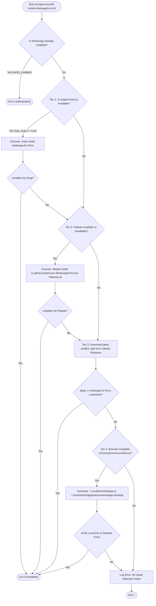

# Specification 21.02: Linux (Ubuntu) WhatsApp Architecture & Desktop Integration

> **Spec ID:** `02-spec/21-app/install-whatsapp-on-windows-server/02-linux-ubuntu-architecture.md`  
> **Feature Version:** `1.1.0`  
> **Status:** `Active / Authoritative`  
> **Domain:** `Linux Desktop Tooling, Enterprise Messaging & Cross-Platform Parity`  
> **Target Environments:** `Ubuntu 20.04, Ubuntu 22.04, Ubuntu 24.04, Debian 11/12`  
> **Script Binding:** `scripts-linux/49-install-whatsapp/run.sh`  
> **Parent Spec:** `02-spec/21-app/install-whatsapp-on-windows-server/readme.md`  

---

## 1. Overview & Problem Context

Meta does not provide an official native `.deb` package or Linux desktop client for WhatsApp. In enterprise Ubuntu and Debian installations, administrators require automated, resilient, and non-interactive WhatsApp provisioning. To guarantee installation across diverse Linux server, cloud, and desktop environments (with or without systemd snapd daemon, Flatpak runtimes, or root-level GUI desktop environments), the Linux WhatsApp engine implements a deterministic 4-tier resolution ladder:

1. **Tier 1 (Snap Package - Preferred Ubuntu Native)**:
   - `snap install whatsapp-for-linux`
   - Canonical's primary desktop sandboxing format on modern Ubuntu desktop/workstations.
   - Requires active `snapd` service and `snap` CLI utility.

2. **Tier 2 (Flatpak App - Cross-Distro Sandboxed Runtime)**:
   - `flatpak install -y --noninteractive flathub io.github.eneshecan.WhatsAppForLinux` (primary)
   - `flatpak install -y --noninteractive flathub com.github.xeco23.WasIstLos` (secondary fallback)
   - Automatically bootstraps `flatpak` via `apt-get` and adds the `flathub` remote repository if missing.

3. **Tier 3 (GitHub Releases .deb Package - Direct System Binary)**:
   - Direct download of latest `_amd64.deb` asset from `github.com/eneshecan/whatsapp-for-linux`.
   - Installed via `dpkg -i` followed by `apt-get install -f -y` dependency resolution.
   - Supports both `whatsapp-for-linux` and `wasistlos` Debian package IDs.

4. **Tier 4 (PWA Desktop Wrapper - Universal Browser Engine Fallback)**:
   - Deploys an XDG-compliant desktop entry (`~/.local/share/applications/whatsapp.desktop`) and standalone launcher executable (`~/.local/bin/whatsapp`).
   - Automatically detects installed Chromium-family browsers (`google-chrome`, `google-chrome-stable`, `chromium-browser`, `chromium`, `brave-browser`, `brave`).
   - Launches WhatsApp Web in application mode: `--app=https://web.whatsapp.com --class=WhatsApp "$@"`.

---

## 2. Directory Layout & Contract

```text
scripts-linux/49-install-whatsapp/
├── run.sh                  # Multi-tier execution entrypoint
├── config.json             # Configuration parameters and timeout bounds
├── log-messages.json       # Externalized log messages
├── manifest.json           # Tool metadata and platform registration
└── readme.txt              # User-facing summary (SP-1..SP-4 compliant)
```

---

## 3. Architecture & Multi-Tier Resolution Ladder



---

## 4. Timeout Safeguards & Operational Bounds

To prevent hanging CI pipelines, unresponsive daemon calls, or slow network connections from stalling unattended installations, strict timeout wrappers guard every network and package manager operation:

- **Download Timeout**:
  - Configured in `scripts-linux/49-install-whatsapp/config.json` via `timeouts.downloadSeconds` (default: 300 seconds).
  - Enforced on all curl HTTP requests (`curl -fsSL --max-time 300`).
  - Enforced on Flatpak remote repository additions (`run_with_timeout 300 flatpak remote-add ...`).

- **Install Timeout**:
  - Configured in `scripts-linux/49-install-whatsapp/config.json` via `timeouts.installSeconds` (default: 600 seconds).
  - Enforced using Linux `timeout(1)` binary wrapper on:
    * `snap install whatsapp-for-linux`
    * `apt-get install -y flatpak`
    * `flatpak install -y --noninteractive flathub <app-id>`
    * `dpkg -i <temp-deb>`
    * `apt-get install -f -y`

- **Missing Timeout Command Guard**:
  - If `timeout` command is absent on minimal containers, `run_with_timeout` logs a warning and falls back to direct execution without crashing.

---

## 5. XDG Desktop Integration (Tier 4 PWA)

For server, lightweight desktop, or containerized environments lacking Snap or Flatpak runtimes, the script synthesizes an XDG-compliant application:

1. **Launcher Script**: `~/.local/bin/whatsapp`
   ```bash
   #!/usr/bin/env bash
   exec "<BROWSER_BIN>" --app=https://web.whatsapp.com --class=WhatsApp "$@"
   ```
   - Executable permissions: `chmod +x ~/.local/bin/whatsapp`.

2. **Desktop Entry**: `~/.local/share/applications/whatsapp.desktop`
   ```ini
   [Desktop Entry]
   Version=1.0
   Name=WhatsApp
   Comment=WhatsApp Desktop Web Client
   Exec=whatsapp %U
   Icon=whatsapp
   Terminal=false
   Type=Application
   Categories=Network;InstantMessaging;
   MimeType=x-scheme-handler/whatsapp;
   ```

---

## 6. CLI Interface & Dispatching

- **Commands Supported**: `install` (default), `check`, `repair`, `uninstall`
- **Dispatcher Shortcuts**:
  - `./run.sh whatsapp` -> invokes script 49 via `run-one-passthrough` with `RUN_ONE_ID="49"`
  - `./run.sh wa` -> short alias invoking script 49
  - `./run.sh install -I 49` -> direct ID invocation
  - `./run.sh check -I 49` -> verify status
  - `./run.sh uninstall -I 49` -> complete cleanup across Snap, Flatpak, dpkg, and PWA
- **Exit Codes**:
  - `0`: Success / Idempotent install / Clean uninstallation
  - `1`: Failure / Verification error / All install methods failed
  - `2`: Unknown command verb

---

## 7. Acceptance Criteria

1. **AC-LIN-01 (4-Tier Resolution)**: Script sequentially attempts Tier 1 (Snap) -> Tier 2 (Flatpak) -> Tier 3 (.deb) -> Tier 4 (PWA) until one tier succeeds.
2. **AC-LIN-02 (Snap Integration)**: When `snap` is available, `snap install whatsapp-for-linux` is invoked and verified via `snap list whatsapp-for-linux`.
3. **AC-LIN-03 (Flatpak Fallback)**: Supports both `io.github.eneshecan.WhatsAppForLinux` and `com.github.xeco23.WasIstLos` Flatpak app identifiers.
4. **AC-LIN-04 (.deb Package Fallback)**: Verifies both `whatsapp-for-linux` and `wasistlos` via `dpkg -s`.
5. **AC-LIN-05 (PWA Desktop Wrapper)**: Deploys `~/.local/bin/whatsapp` and `~/.local/share/applications/whatsapp.desktop` when a supported browser (`google-chrome`, `chromium-browser`, `brave-browser`) is present.
6. **AC-LIN-06 (Timeout Guards)**: All downloads and package manager operations are strictly bounded by `downloadSeconds` and `installSeconds` from `config.json`.
7. **AC-LIN-07 (Complete Uninstallation)**: `verb_uninstall` cleans up Snap, Flatpak, dpkg, and PWA files without leaving orphaned shortcuts or packages.
8. **AC-LIN-08 (Coding Guidelines Compliance)**: Adheres strictly to AGENTS.md: affirmative booleans (`is*`, `has*`), micro-functions (<= 8-15 lines), zero nested `if` statements, mandatory vertical spacing, and `log_file_error` for file/path failures.
