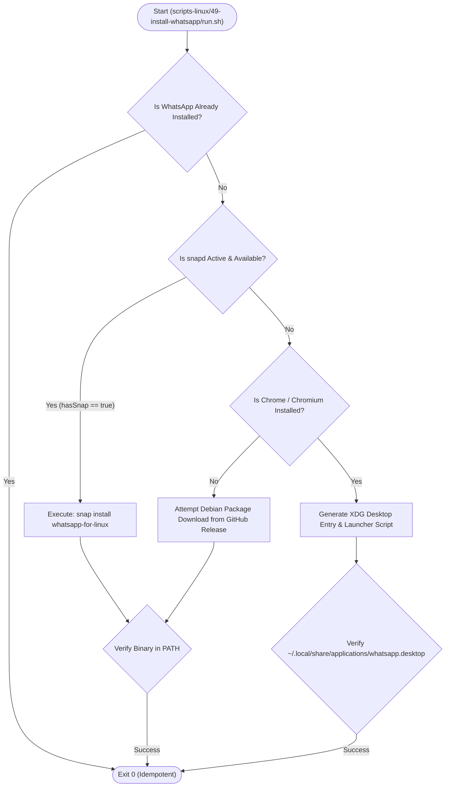

# Specification 21.02: Linux (Ubuntu) WhatsApp Architecture & Desktop Integration

> **Spec ID:** `02-spec/21-app/install-whatsapp-on-windows-server/02-linux-ubuntu-architecture.md`  
> **Feature Version:** `1.0.0`  
> **Status:** `Active / Authoritative`  
> **Domain:** `Linux Desktop Tooling, Enterprise Messaging & Cross-Platform Parity`  
> **Target Environments:** `Ubuntu 20.04, Ubuntu 22.04, Ubuntu 24.04, Debian 11/12`  
> **Script Binding:** `scripts-linux/49-install-whatsapp/run.sh`  
> **Parent Spec:** `02-spec/21-app/install-whatsapp-on-windows-server/readme.md`  

---

## 1. Overview & Problem Context

Meta does not provide an official native `.deb` package or Linux desktop client for WhatsApp. As a result, Linux enterprise installations rely on two primary installation paradigms:

1. **Native Client Package (`whatsapp-for-linux`)**:
   - An open-source, full-featured desktop client wrapper written in C++/gtk/webkit.
   - Available as a Snap package (`snap install whatsapp-for-linux`) and `.deb` package.
2. **Chromium-Engine Desktop Web App (PWA) Fallback**:
   - For server or containerized Ubuntu environments lacking Snap daemon (`snapd`) or desktop stores, creating an XDG-compliant desktop entry (`whatsapp.desktop`) invoking Google Chrome, Chromium, or Brave with `--app=https://web.whatsapp.com`.

---

## 2. Directory Layout & Contract

```text
scripts-linux/49-install-whatsapp/
├── run.sh                  # Execution entrypoint
├── config.json             # Configuration parameters
├── log-messages.json       # Externalized log messages
├── manifest.json           # Tool metadata
└── readme.md               # User documentation
```

---

## 3. Architecture & Multi-Tier Linux Flow



---

## 4. XDG Desktop Integration

For the browser-backed engine, the script creates:
1. Entrypoint Script: `~/.local/bin/whatsapp`
   ```bash
   #!/usr/bin/env bash
   exec "${BROWSER_BIN}" --app=https://web.whatsapp.com --class=WhatsApp "$@"
   ```
2. Desktop Entry: `~/.local/share/applications/whatsapp.desktop`
   ```ini
   [Desktop Entry]
   Version=1.0
   Name=WhatsApp
   Comment=WhatsApp Desktop Client
   Exec=whatsapp %U
   Icon=whatsapp
   Terminal=false
   Type=Application
   Categories=Network;InstantMessaging;
   MimeType=x-scheme-handler/whatsapp;
   ```

---

## 5. CLI Interface & Dispatching

- **Commands Supported**: `install` (default), `uninstall`, `--help`
- **Exit Codes**:
  - `0`: Success / Idempotent
  - `1`: Failure / Verification Error
- **Integration**:
  - Registered in `scripts-linux/run.sh` dispatcher.
  - Linked in root `run.ps1` for cross-platform execution awareness.

---

## 6. Coding Guidelines Compliance

- Target <= 8–15 lines per function.
- Affirmative booleans: `is_installed`, `has_snap`, `has_chrome`.
- No nested `if` statements — use early returns and guard clauses.
- Blank lines before `if`, after `}`, and before `return`.
