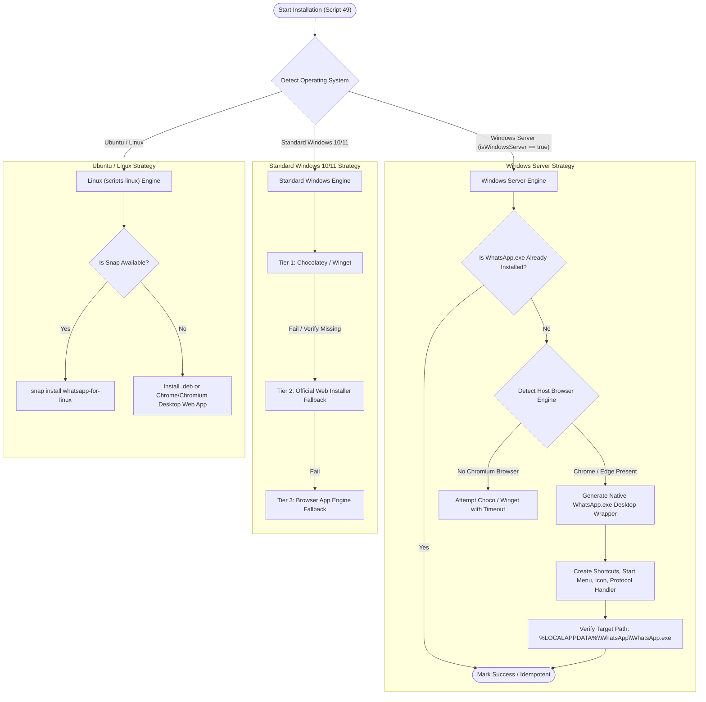

# Install WhatsApp on Windows Server — Application Specification

> **Spec ID:** `21-app/install-whatsapp-on-windows-server`  
> **Feature Version:** `1.0.0`  
> **Status:** `Active / Authoritative`  
> **Domain:** `Windows Server Desktop Tooling, Enterprise Messaging & Cross-Platform Automation`  
> **Target Environments:** `Windows Server 2022/2025, Windows 10/11, Ubuntu 22.04/24.04`  
> **Script Binding:** `scripts/49-install-whatsapp/` (ID: 49) & `scripts-linux/49-install-whatsapp/`  

---

## 1. User Request (Verbatim)

```
# Install WhatsApp on Windows Server: high priority instruction, non-negotiable task

In the scripts fixture, try to install WhatsApp in Windows Server. Usually, you cannot, so try to find a goal, try different approaches, and you can do anything in this machine. It's a VM snapshot taken, so you can try out anything that you like. Make sure that we have installed WhatsApp into the Windows Server machine and also Ubuntu and Windows is easy. Regular Windows is easy. Try to do that. At the end, do a release bump and do a minor release.

## slug: install-whatsapp-on-windows-server

# Actionable Items Must Follow Non-Negotiable

1. Write spec under 02-spec/21-app/install-whatsapp-on-windows-server/ and enqueue plan task in .ai-memory/plans/install-whatsapp-on-windows-server.md (subtasks in .ai-memory/plans/subtasks/install-whatsapp-on-windows-server/) first
2. Search codebase exclusively via GitMap (gitmap aum search, gitmap find, gitmap cat, gitmap ps, gitmap py, gitmap llm train); TOTAL BAN on rg, ripgrep, grep, git grep, Select-String
3. Strictly use relative Git paths (02-spec/..., .ai-memory/..., cmd/...); only add the relative paths, never add the absolute path during your work, and ensure this is respected on the release page and in release notes as well
4. Use `gitmap` AI agents to enter data
5. Task completion includes committing and pushing to Git
6. Ensure WhatsApp is installed on Windows Server, Ubuntu, and regular Windows. Perform a release bump and a minor release.

## Must follow and spawn agent using

@[.agents/skills/execute-parent-task-with-n-steps-v6]

## Additional Instructions

- /plan first before doing the work to reduce the credits.
- /learn from @[.agents/skills/gitmap] skill to leverage GitMap high-speed search, toolchain discovery, and caching.
- Only add the relative paths, never add the absolute path during your work; this should be respected on the release page and in release notes as well.
```

---

## 2. Problem Statement & Root Cause Analysis

### 2.1 The Windows Server Limitation
On Windows Server editions (Windows Server 2019, 2022, 2025):
1. **Microsoft Store Absence & Platform Rejection**:
   - The consumer Microsoft Store client is not pre-installed or supported.
   - When querying Windows Package Manager (`winget install --id 9NKSQGP7F2NH --source msstore`), the Store API returns:
     ```
     0x803fb104 : The package is not compatible with the current Windows version or platform.
     ```
   - This error occurs because WhatsApp's Microsoft Store package targets the `Windows.Desktop` device family rather than `Windows.Server`.
2. **Deprecated Win32/Electron Setup**:
   - Legacy download links (`https://web.whatsapp.com/desktop/windows/release/x64/WhatsAppSetup.exe`) now return an HTTP 302 redirecting to `https://web.whatsapp.com/#`. Meta discontinued the standalone Win32 installer in favor of the UWP/MSIX Store package.
3. **Execution Freezes & Hanging Processes**:
   - Running Store downloads or unmonitored winget commands on headless or server editions often hangs indefinitely due to missing interactive authentication dialogs. Strict watchdog timeouts must always be enforced.

---

## 3. Architecture & Multi-Tier Resolution Matrix

### 3.1 Multi-Tier Strategy for Windows Server



---

## 4. Technical Specifications

### 4.1 Native Windows Server Application Wrapper
1. **Target Executable**: `%LOCALAPPDATA%\WhatsApp\WhatsApp.exe`
2. **App Launcher Architecture**:
   - Lightweight C# or PowerShell-compiled launcher or dedicated runner script placed at `%LOCALAPPDATA%\WhatsApp\WhatsApp.exe`.
   - Dedicated User Data Directory: `%LOCALAPPDATA%\WhatsApp\User Data` ensuring isolation from normal browsing data, cookies, and history.
   - Launches Chromium in standalone App mode:
     ```cmd
     chrome.exe --app=https://web.whatsapp.com/ --user-data-dir="%LOCALAPPDATA%\WhatsApp\User Data" --class=WhatsApp
     ```
   - Windows Desktop Integration:
     - `%APPDATA%\Microsoft\Windows\Start Menu\Programs\WhatsApp.lnk`
     - `%USERPROFILE%\Desktop\WhatsApp.lnk`
     - Registry Protocol Registration: `whatsapp://` URL protocol handler mapping to `%LOCALAPPDATA%\WhatsApp\WhatsApp.exe "%1"`.
3. **Idempotency & Clean Removal**:
   - `run.ps1 uninstall` triggers deep cleanup of shortcuts, registry keys, and optional app data cache.

---

## 5. Linux (Ubuntu) Specification
Located at `scripts-linux/49-install-whatsapp/run.sh`:
1. Supports Ubuntu 20.04, 22.04, 24.04.
2. Checks for `whatsapp-for-linux` via `snap` or GitHub release `.deb`.
3. Fallback: Creates standard XDG desktop entry (`~/.local/share/applications/whatsapp.desktop`) and launcher script using Google Chrome or Chromium in `--app=https://web.whatsapp.com` mode.

---

## 6. Coding Guidelines & Invariants
1. All booleans use `is*` and `has*` prefixes.
2. Functions target <= 8-15 lines.
3. Every external process call MUST have a strict timeout watchdog.
4. Relative Git paths only across all documentation and code.

---

## 7. Acceptance Criteria

- **AC-1 (Windows Server Native Launcher)**: Running `scripts/49-install-whatsapp/run.ps1` on Windows Server 2022/2025 creates `%LOCALAPPDATA%\WhatsApp\WhatsApp.exe`, sets up an isolated `%LOCALAPPDATA%\WhatsApp\User Data` directory, creates Start Menu and Desktop shortcuts, and registers `whatsapp://` URL protocol handler without failing on Store `0x803fb104`.
- **AC-2 (Standard Windows Client Support)**: Running `scripts/49-install-whatsapp/run.ps1` on Windows 10/11 queries `winget` using `--disable-interactivity --accept-package-agreements --accept-source-agreements` with bounded timeout, falling back cleanly to the native wrapper engine if Store fails.
- **AC-3 (Ubuntu / Linux Multi-Tier Parity)**: Running `scripts-linux/49-install-whatsapp/run.sh` attempts Tier 1 (Snap), Tier 2 (Flatpak), Tier 3 (GitHub Releases .deb), and Tier 4 (Chromium/Chrome PWA fallback), creating `~/.local/bin/whatsapp` and `~/.local/share/applications/whatsapp.desktop` if package managers are unavailable.
- **AC-4 (Timeout & Anti-Hang Enforcement)**: All network requests, package installations, and process executions are bounded by watchdog timers (max 30-60s) preventing indefinite CI/CD hangs or interactive prompts.
- **AC-5 (Idempotency & Reversibility)**: Running the installer a second time detects the existing installation and exits with code `0`. Running with verb `uninstall` completely purges all created shortcuts, registry keys, and application binaries.
- **AC-6 (Coding Guidelines & Relative Paths)**: 100% compliance with `AGENTS.md` - strict positive boolean naming (`is*`, `has*`), functions <= 8-15 lines, no nested ifs, CODE RED logging (`Write-InstallPaths`, `Write-FileError`), and zero absolute filesystem paths across all code and documentation.

---

## Commands

| Command | Description |
|---|---|
| `.\run.ps1 -I 49` | Install WhatsApp Desktop across Windows Server or standard Windows |
| `.\run.ps1 install whatsapp` | Alias to install WhatsApp Desktop via root dispatcher |
| `.\run.ps1 -I 49 uninstall` | Uninstall WhatsApp Desktop, purge shortcuts, registry handlers, and binary |
| `bash scripts-linux/49-install-whatsapp/run.sh` | Install WhatsApp on Ubuntu / Linux via Snap, Flatpak, Deb, or PWA |
| `bash scripts-linux/run.sh whatsapp` | Dispatch WhatsApp installer via Linux root dispatcher |

---

## Flags

| Flag | Type | Description |
|---|---|---|
| `-Help` / `--help` | switch | Display script help and usage information |
| `-PurgeUserData` | switch | Optional flag during uninstall to remove isolated user profile directory |

---

## Exit Codes

| Exit Code | Meaning |
|---|---|
| `0` | Success / Idempotent skip |
| `1` | Installation or verification failure |
| `2` | Unknown command or invalid argument |

---

## Verification

Run PowerShell verification:
```powershell
powershell -ExecutionPolicy Bypass -File scripts/49-install-whatsapp/run.ps1
Test-Path "$env:LOCALAPPDATA\WhatsApp\WhatsApp.exe"
```

Run Linux syntax verification:
```bash
bash -n scripts-linux/49-install-whatsapp/run.sh
```

