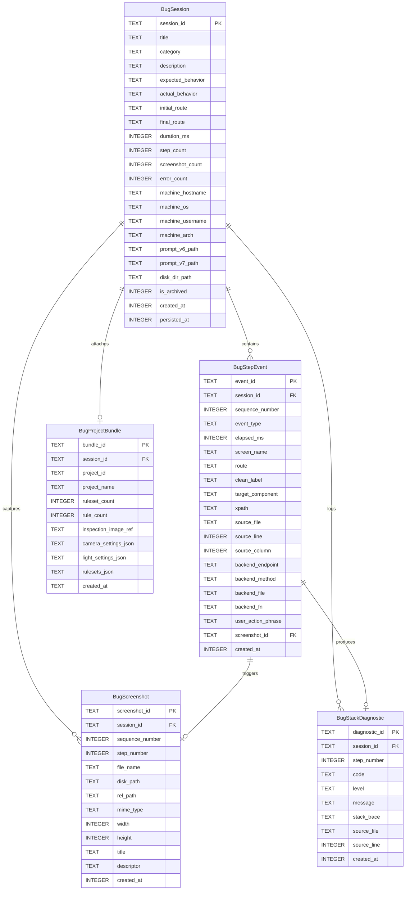

# Specification 27.03: Normalized SQLite Database Schema (3NF)

## 1. Relational Normalization Architecture

Opaque JSON blobs in database columns prevent fast indexing, granular filtering, and targeted SQL querying by AI diagnostic engines. This specification defines a **fully normalized 3rd Normal Form (3NF) relational SQLite schema** for recorded bug sessions, interaction steps, screenshots, and attached project bundles.

### Entity-Relationship Diagram



---

## 2. Complete SQLite DDL Definitions

```sql
-- Table 1: Primary Bug Sessions
CREATE TABLE IF NOT EXISTS bug_sessions (
    session_id TEXT PRIMARY KEY,
    title TEXT NOT NULL,
    category TEXT NOT NULL DEFAULT 'other',
    description TEXT,
    expected_behavior TEXT,
    actual_behavior TEXT,
    initial_route TEXT NOT NULL DEFAULT '/',
    final_route TEXT,
    duration_ms INTEGER NOT NULL DEFAULT 0,
    step_count INTEGER NOT NULL DEFAULT 0,
    screenshot_count INTEGER NOT NULL DEFAULT 0,
    error_count INTEGER NOT NULL DEFAULT 0,
    machine_hostname TEXT NOT NULL,
    machine_os TEXT NOT NULL,
    machine_username TEXT NOT NULL,
    machine_arch TEXT NOT NULL DEFAULT 'x86_64',
    prompt_v6_path TEXT,
    prompt_v7_path TEXT,
    disk_dir_path TEXT NOT NULL,
    is_archived INTEGER NOT NULL DEFAULT 0,
    created_at INTEGER NOT NULL,
    persisted_at INTEGER NOT NULL
);

-- Table 2: Step-by-Step Normalized Interaction Events
CREATE TABLE IF NOT EXISTS bug_step_events (
    event_id TEXT PRIMARY KEY,
    session_id TEXT NOT NULL,
    sequence_number INTEGER NOT NULL,
    event_type TEXT NOT NULL,
    elapsed_ms INTEGER NOT NULL DEFAULT 0,
    screen_name TEXT NOT NULL,
    route TEXT NOT NULL,
    clean_label TEXT NOT NULL,
    target_component TEXT,
    xpath TEXT,
    source_file TEXT,
    source_line INTEGER,
    source_column INTEGER,
    backend_endpoint TEXT,
    backend_method TEXT,
    backend_file TEXT,
    backend_fn TEXT,
    user_action_phrase TEXT,
    screenshot_id TEXT,
    created_at INTEGER NOT NULL,
    FOREIGN KEY (session_id) REFERENCES bug_sessions(session_id) ON DELETE CASCADE
);

-- Table 3: Recorded Screenshots Catalog
CREATE TABLE IF NOT EXISTS bug_screenshots (
    screenshot_id TEXT PRIMARY KEY,
    session_id TEXT NOT NULL,
    sequence_number INTEGER NOT NULL,
    step_number INTEGER,
    file_name TEXT NOT NULL,
    disk_path TEXT NOT NULL,
    rel_path TEXT NOT NULL,
    mime_type TEXT NOT NULL DEFAULT 'image/png',
    width INTEGER NOT NULL DEFAULT 1920,
    height INTEGER NOT NULL DEFAULT 1080,
    title TEXT,
    descriptor TEXT,
    created_at INTEGER NOT NULL,
    FOREIGN KEY (session_id) REFERENCES bug_sessions(session_id) ON DELETE CASCADE
);

-- Table 4: Project Configuration Bundles for 1-Click Reproduction
CREATE TABLE IF NOT EXISTS bug_project_bundles (
    bundle_id TEXT PRIMARY KEY,
    session_id TEXT NOT NULL UNIQUE,
    project_id TEXT NOT NULL,
    project_name TEXT NOT NULL,
    ruleset_count INTEGER NOT NULL DEFAULT 0,
    rule_count INTEGER NOT NULL DEFAULT 0,
    inspection_image_ref TEXT,
    camera_settings_json TEXT,
    light_settings_json TEXT,
    rulesets_json TEXT,
    created_at INTEGER NOT NULL,
    FOREIGN KEY (session_id) REFERENCES bug_sessions(session_id) ON DELETE CASCADE
);

-- Table 5: Stack Traces & Diagnostic Errors
CREATE TABLE IF NOT EXISTS bug_stack_diagnostics (
    diagnostic_id TEXT PRIMARY KEY,
    session_id TEXT NOT NULL,
    step_number INTEGER,
    code TEXT NOT NULL,
    level TEXT NOT NULL DEFAULT 'error',
    message TEXT NOT NULL,
    stack_trace TEXT,
    source_file TEXT,
    source_line INTEGER,
    created_at INTEGER NOT NULL,
    FOREIGN KEY (session_id) REFERENCES bug_sessions(session_id) ON DELETE CASCADE
);

-- Performance Indexes for Fast Sub-Millisecond AI CLI Queries
CREATE INDEX IF NOT EXISTS idx_bug_sessions_created ON bug_sessions(created_at DESC);
CREATE INDEX IF NOT EXISTS idx_bug_sessions_category ON bug_sessions(category);
CREATE INDEX IF NOT EXISTS idx_bug_sessions_hostname ON bug_sessions(machine_hostname);
CREATE INDEX IF NOT EXISTS idx_bug_step_events_session_seq ON bug_step_events(session_id, sequence_number);
CREATE INDEX IF NOT EXISTS idx_bug_step_events_source_file ON bug_step_events(source_file);
CREATE INDEX IF NOT EXISTS idx_bug_screenshots_session ON bug_screenshots(session_id, sequence_number);
CREATE INDEX IF NOT EXISTS idx_bug_stack_diagnostics_session ON bug_stack_diagnostics(session_id);
```

---

## 3. High-Speed SQL Queries for AI Diagnostics

### Query 1: Retrieve Step N with Source Code and Screenshot
```sql
SELECT
    e.sequence_number,
    e.elapsed_ms,
    e.screen_name,
    e.route,
    e.clean_label,
    e.target_component,
    e.xpath,
    e.source_file,
    e.source_line,
    e.backend_endpoint,
    e.backend_file,
    e.backend_fn,
    s.disk_path AS screenshot_path,
    d.stack_trace,
    sess.machine_hostname,
    sess.machine_username
FROM bug_step_events e
JOIN bug_sessions sess ON e.session_id = sess.session_id
LEFT JOIN bug_screenshots s ON e.session_id = s.session_id AND e.sequence_number = s.step_number
LEFT JOIN bug_stack_diagnostics d ON e.session_id = d.session_id AND e.sequence_number = d.step_number
WHERE e.session_id = :session_id AND e.sequence_number = :step_number;
```

### Query 2: List Recent Bugs with Machine and Step Metadata
```sql
SELECT
    s.session_id,
    s.title,
    s.category,
    s.step_count,
    s.screenshot_count,
    s.error_count,
    s.duration_ms,
    s.machine_hostname,
    s.machine_username,
    s.machine_os,
    s.created_at,
    b.project_name
FROM bug_sessions s
LEFT JOIN bug_project_bundles b ON s.session_id = b.session_id
WHERE s.is_archived = 0
ORDER BY s.created_at DESC
LIMIT :limit;
```
